# RMIT HACKATHON 2026 — KẾ HOẠCH TÁC CHIẾN SOLO (1 NGƯỜI)

> **Cập nhật:** 22/10/2026 lúc 10:55 (Giờ Việt Nam)  
> **Người thực hiện:** Bạn (Solo) + AI Co-pilot (Antigravity)  
> **Link cuộc thi:** [Kaggle RMIT Hackathon 2026](https://www.kaggle.com/competitions/rmit-hackathon-2026)

---

> [!CAUTION]
> ### ⏰ ĐỒNG HỒ ĐẾM NGƯỢC & DEADLINE SỐNG CÒN
> * **DEADLINE CHÍNH THỨC CỦA KAGGLE:** **18:00 hôm nay (22/10)** — tức 11:00 UTC.
> * **HARD STOP NỘP BÀI (HẠN NỘI BỘ):** **17:00 – 17:30**. 
> * **Sau 17:30:** Tuyệt đối không bấm train job mới. Chỉ kiểm tra và chọn 2 bài nộp chính thức (Final Submissions).

---

## 1. Tóm tắt bài toán & Luật thi (Đọc trong 1 phút)

| Tiêu chí | Thông tin cốt lõi | Lưu ý chiến thuật |
|---|---|---|
| **Đề bài** | Phân loại prompt thành 3 lớp: `BENIGN`, `JAILBREAK`, `PROMPT_INJECTION` | Phân loại văn bản đa lớp (Multi-class text classification) |
| **Dữ liệu** | `train.csv` (14.000 dòng), `test.csv` (6.000 dòng) | Đã có sẵn trong thư mục `data/` |
| **Ngôn ngữ** | Tiếng Bồ Đào Nha (pt 45%), Pháp (fr 25%), Ý (it 20%), Anh (en 10%) | Dùng mô hình đa ngôn ngữ (Multilingual Transformer: XLM-RoBERTa) |
| **Tỷ lệ lớp** | `BENIGN`: 62% \| `JAILBREAK`: 31% \| `PROMPT_INJECTION`: **7%** | **CỰC KỲ LỆCH LỚP:** Lớp Prompt Injection rất ít nhưng quyết định thứ hạng! |
| **Metric tính điểm** | **Macro F1** (Trung bình cộng F1 của cả 3 lớp với trọng số ngang nhau) | F1 của lớp 7% quan trọng ngang ngửa lớp 62%! |
| **Luật Model** | Chỉ được dùng **1 trong 10 model trong danh sách duyệt của Kaggle** | Chọn duy nhất backbone: `FacebookAI/xlm-roberta-large` (hoặc `base`) |
| **Quy định Notebook** | Dòng đầu tiên của code notebook: `# MODEL: FacebookAI/xlm-roberta-large` Tên notebook: `<uni>_<campus>_<team>_C1` | Bắt buộc tuân thủ để không bị hủy bài |
| **Quota nộp bài** | Tối đa **6 lượt nộp / ngày** | Tiết kiệm quota, mỗi lần nộp phải có mục đích rõ ràng |

---

## 2. Lộ trình tác chiến từng giờ (11:00 – 17:30)

Do chỉ làm một mình, toàn bộ kế hoạch được tối ưu để **chạy tuần tự, không nghẽn GPU, không phức tạp hóa**.

```mermaid
gantt
    title Lịch trình Solo Hackathon (22/10)
    dateFormat  HH:mm
    axisFormat  %H:%M
    section Tác chiến
    P1 - Baseline thông sàn (Sub #1)       :a1, 11:00, 45m
    P2 - Large + Class Weight (Sub #2)     :a2, after a1, 110m
    P3 - Head+Tail & Threshold (Sub #3)    :a3, after a2, 90m
    P4 - Ensemble & Final Sub (Sub #4)     :a4, after a3, 60m
    P5 - Khóa sổ & Chọn Final              :a5, after a4, 45m
```

### Chi tiết từng khung giờ:

### 🔹 Khung 1: 11:00 – 11:45 | Khởi động & Nộp Baseline thông sàn
* **Mục tiêu:** Có ngay 1 bài nộp hợp lệ đầu tiên trên Leaderboard để an tâm hệ thống chấm bài nhận diện được file.
* **Hành động:**
  - AI viết sẵn notebook Baseline nhẹ (`xlm-roberta-base`, max_len=256, 1 epoch nhanh).
  - Bạn mở Kaggle, paste code, bật GPU T4/P100 và ấn chạy (~15-20 phút).
  - Tải file `submission.csv` nộp ngay lên Kaggle.
* **Đầu ra:** **Sub #1** thành công, có điểm baseline trên Public Leaderboard.

---

### 🔹 Khung 2: 11:45 – 13:45 | Vũ khí hạng nặng (`XLM-RoBERTa-large` + Class Weights)
* **Mục tiêu:** Cú nhảy vọt điểm số lớn nhất bằng mô hình Large chuẩn + cứu điểm lớp hiếm.
* **Hành động:**
  - Nâng cấp lên `FacebookAI/xlm-roberta-large`.
  - Cấu hình siêu tham số chống sập: `learning_rate = 1e-5`, `warmup_ratio = 0.1`, `max_grad_norm = 1.0`, `batch_size = 8` (kèm gradient accumulation = 2 để đạt effective batch = 16).
  - **Đòn bẩy:** Áp dụng **Class-Weighted Cross Entropy Loss** (tăng phạt nếu đoán sai lớp `PROMPT_INJECTION` để kéo F1 lớp này từ 0.7 lên 0.9+).
  - Train 2 epoch trên tập Stratified Split 85/15.
* **Đầu ra:** Xuất `submission_v2_large.csv` → **Nộp Sub #2**.

---

### 🔹 Khung 3: 13:45 – 15:15 | Đòn kỹ thuật: Head + Tail Truncation & Post-processing
* **Mục tiêu:** Khai thác đặc trưng câu lệnh dài và tối ưu ngưỡng xác suất.
* **Hành động:**
  - **Bắt prompt dài:** Dữ liệu có văn bản lên tới 18.000 ký tự. Kẻ tấn công prompt injection thường giấu lệnh độc hại ở cuối văn bản. Tokenizer chuẩn sẽ lấy **256 token đầu + 256 token cuối** (Head + Tail) thay vì chỉ lấy 512 token đầu.
  - **Threshold Tuning:** Tinh chỉnh nhẹ ngưỡng xác suất cho lớp `PROMPT_INJECTION` trên tập Validation để tối đa hóa Macro F1.
* **Đầu ra:** Xuất `submission_v3_headtail.csv` → **Nộp Sub #3**.

---

### 🔹 Khung 4: 15:15 – 16:30 | Gộp mô hình (Ensemble) & Nộp bài Final ứng viên
* **Mục tiêu:** Kết hợp sức mạnh để đạt điểm số cao nhất và ổn định nhất trên Private Leaderboard.
* **Hành động:**
  - Gộp trung bình có trọng số xác suất (Probability Blend) giữa bản Large chuẩn (Khung 2) và bản Head-Tail (Khung 3).
  - Kiểm tra kỹ: Đủ 6.000 dòng test, không có giá trị trống (NaN), ID khớp 100% với `sample_submission.csv`.
* **Đầu ra:** Xuất `submission_final_ensemble.csv` → **Nộp Sub #4** (Ứng viên vô địch).

---

### 🔹 Khung 5: 16:30 – 17:30 | Khóa sổ & Đóng gói an toàn
* **Mục tiêu:** Chống rủi ro phút chót.
* **Hành động:**
  - Dừng toàn bộ các job train mới.
  - Vào tab **Submissions** trên Kaggle, tick chọn **2 bản tốt nhất** làm **Final Submissions** (thường chọn: 1 bản điểm Public cao nhất + 1 bản điểm Validation local uy tín nhất).
  - Kiểm tra notebook lưu lại: Tên notebook đúng chuẩn `<uni>_<campus>_<team>_C1`, dòng đầu tiên đúng `# MODEL: FacebookAI/xlm-roberta-large`.
  - Chụp ảnh màn hình lưu bằng chứng.

---

## 3. Chiến lược phân bổ 6 lượt nộp Kaggle (Solo Quota)

| Lượt | Thời gian dự kiến | Mục đích | Tiêu chí chấp nhận |
|:---:|:---:|---|---|
| **Sub 1** | ~11:45 | **Baseline kiểm tra thông sàn** | Chấm thành công, điểm > 0.80 |
| **Sub 2** | ~13:45 | **XLM-RoBERTa-large + Class Weight** | Điểm tăng vọt, Macro F1 cải thiện rõ |
| **Sub 3** | ~15:15 | **Head + Tail Truncation** | Kiểm tra hiệu quả bắt prompt dài |
| **Sub 4** | ~16:15 | **Ensemble Blend tốt nhất** | Ứng viên điểm cao nhất để chọn Final |
| **Sub 5** | Dự phòng | Dùng nếu Sub 3 hoặc Sub 4 gặp trục trặc định dạng | Chỉ nộp khi đã sửa lỗi triệt để |
| **Sub 6** | Dự phòng | Giữ nguyên đến sau 17:00, phòng sự cố hệ thống | Không dùng tùy tiện |

---

## 4. Phân công phối hợp giữa Bạn và AI Co-pilot

| Việc | AI Co-pilot (Tôi) | Bạn (Thực thi trên Kaggle) |
|---|---|---|
| **Viết Code** | Viết hoàn chỉnh notebook sạch từ đầu đến cuối, chú thích tiếng Việt | Copy code vào Kaggle Notebook |
| **Môi trường & GPU** | Cấu hình tham số vừa khít VRAM GPU (T4 / P100), chống tràn bộ nhớ | Bật GPU Accelerator trong Notebook Settings |
| **Xử lý Dữ liệu** | Viết code chia Stratified split, custom loss, tokenization | Chạy cell và xem log kết quả |
| **Đánh giá & Gỡ lỗi** | Tính toán Macro F1, đọc traceback nếu gặp lỗi và sửa ngay trong 2 phút | Copy lỗi (nếu có) dán lại cho AI |
| **Nộp bài** | Kiểm tra format file, đối chiếu ID, số dòng, cột label | Bấm Submit và báo điểm số về |

---

## 5. Bắt đầu ngay bước 1!

Bây giờ là **10:55**. Chúng ta sẽ bắt tay vào **Khung 1 (Tạo Baseline Sub #1)** ngay lập tức.
Tôi sẽ tạo sẵn code Notebook hoàn chỉnh cho bạn!
